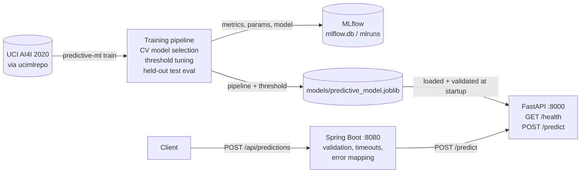

# Predictive Maintenance ML System

Unplanned machine failures cause production downtime and expensive repairs.
This project trains a classifier that estimates the probability that a milling
machine will fail, given its operating conditions (product type, temperatures,
rotational speed, torque and tool wear). It is aimed at maintenance and
reliability engineers who want a failure-risk score per operating snapshot.

The current prototype covers the full path from training to a served
prediction. It trains and evaluates models on the public UCI AI4I 2020 dataset
and tracks the experiments in MLflow. A FastAPI service serves the chosen model,
and a Spring Boot service exposes it to Java clients. This is a work in
progress: see [Status](#current-status) and [Roadmap](#roadmap).

## Architecture



| Path | Purpose |
|---|---|
| `src/predictive_ml/data.py` | Downloads AI4I 2020 (UCI id 601) and selects the 6 model features |
| `src/predictive_ml/models.py` | Candidate models: dummy baseline, logistic regression, random forest |
| `src/predictive_ml/train.py` | Split, cross-validation, threshold selection, final test evaluation, MLflow logging, save |
| `src/predictive_ml/artifact.py` | Feature contract (names, order, units) and model-artifact save/load/validation |
| `src/predictive_ml/api.py` | FastAPI inference service |
| `src/predictive_ml/__init__.py` | `predictive-ml` CLI (`train`, `serve`) |
| `web-service/` | Spring Boot 4 service that validates requests and forwards them to the Python API |
| `models/` | Committed artifacts: `predictive_model.joblib` (served model), `baseline_model.joblib` (an early logistic-regression pipeline, kept for history) |
| `mlflow.db` | Local MLflow tracking database with the experiment history |

## Stack and data

- **Python 3.14** (pinned in `.python-version`), managed with [uv](https://docs.astral.sh/uv/). Uses scikit-learn 1.9, pandas, MLflow 3, FastAPI, pydantic 2 and uvicorn. Exact versions are locked in `uv.lock`.
- **Java 21**, Spring Boot 4.1 (Web MVC, `RestClient`, Bean Validation), and Maven through the included wrapper.
- **Dataset:** [AI4I 2020 Predictive Maintenance Dataset](https://archive.ics.uci.edu/dataset/601/ai4i+2020+predictive+maintenance+dataset) by S. Matzka, UCI Machine Learning Repository, 2020, DOI [10.24432/C5HS5C](https://doi.org/10.24432/C5HS5C). The UCI page licenses it under **CC BY 4.0**, so any redistribution or derived publication must credit the source. The data is synthetic and models a milling process. It is not real plant data. The dataset is downloaded at training time and is **not** stored in this repository.

### Feature contract

`ucimlrepo` returns the column names **without** unit suffixes. The model was
fitted on these names, so the API maps its camelCase fields onto them:

| API field (JSON) | Model column | Unit | Type / constraint |
|---|---|---|---|
| `type` | `Type` | – | `"L"`, `"M"` or `"H"` (low/medium/high product quality) |
| `airTemperature` | `Air temperature` | K | number > 0 |
| `processTemperature` | `Process temperature` | K | number > 0 |
| `rotationalSpeed` | `Rotational speed` | rpm | integer ≥ 0 |
| `torque` | `Torque` | Nm | number ≥ 0 |
| `toolWear` | `Tool wear` | min | integer ≥ 0 |

The API refuses to start if the model's `feature_names_in_` do not match this
list. A regression test also covers this check.

## Requirements and setup

- Python 3.14 via `uv` (uv ≥ 0.12; it will download Python 3.14 if needed)
- JDK 21 (Maven is fetched by `./mvnw`)
- Internet access is needed only for the first dependency install and for training (dataset download)

```bash
git clone https://github.com/Ricardo-LK/predictive-ml.git
cd predictive-ml
uv sync                      # creates .venv from uv.lock (includes dev tools)
```

## Run it

### 1. Model (optional: a trained model is already committed)

`models/predictive_model.joblib` is ready to serve, so serving and tests work offline.
To retrain (**needs internet**: downloads the dataset from archive.ics.uci.edu):

```bash
uv run predictive-ml train
```

Retraining **overwrites** `models/predictive_model.joblib` and adds runs to
`mlflow.db`. To experiment without touching the committed files, redirect both:

```bash
PREDICTIVE_ML_MODEL_PATH=/tmp/model.joblib MLFLOW_TRACKING_URI=sqlite:////tmp/mlflow.db uv run predictive-ml train
```

Browse experiments with `uv run mlflow ui --backend-store-uri sqlite:///mlflow.db`.

### 2. Python inference API (offline)

```bash
uv run predictive-ml serve            # http://127.0.0.1:8000, docs at /docs
# equivalently: uv run uvicorn predictive_ml.api:app --port 8000
```

The model is loaded and validated at startup. If the file is missing or
incompatible, the server exits with an explanatory `ModelArtifactError`. To load
a different artifact, set `PREDICTIVE_ML_MODEL_PATH`.

### 3. Spring Boot service (offline after first Maven download)

```bash
cd web-service
./mvnw spring-boot:run                # http://localhost:8080
```

The settings live in `web-service/src/main/resources/application.properties`:
`ml.service.url` (default `http://localhost:8000`), `ml.service.connect-timeout` (default `2s`)
and `ml.service.read-timeout` (default `5s`).

## API examples

The two services use the same request body:

```bash
curl -s localhost:8000/health
# {"status":"alive"}

curl -s -H 'Content-Type: application/json' localhost:8000/predict -d '{
  "type": "L", "airTemperature": 298.1, "processTemperature": 308.6,
  "rotationalSpeed": 1551, "torque": 42.8, "toolWear": 0 }'

curl -s -H 'Content-Type: application/json' localhost:8080/api/predictions -d '{
  "type": "L", "airTemperature": 298.1, "processTemperature": 308.6,
  "rotationalSpeed": 1551, "torque": 42.8, "toolWear": 0 }'
```

Response (identical for both endpoints):

```json
{"prediction": <0 or 1>, "failureProbability": <0.0–1.0>, "threshold": <decision threshold, currently 0.5>}
```

`prediction` is `1` when `failureProbability >= threshold`.

Error behaviour:

| Situation | FastAPI `/predict` | Spring `/api/predictions` |
|---|---|---|
| Missing / wrong-typed / out-of-range field, unknown `type`, unexpected field | 422 with pydantic `detail` list | 400 problem+json with an `errors` map per field |
| Malformed JSON | 422 | 400 |
| Python API unreachable or timed out | – | 503 problem+json |
| Python API returns an error or incomplete body | – | 502 problem+json |

The Spring service is stricter about unexpected fields than the Python API. FastAPI
rejects unknown fields, but Spring ignores them because that is Jackson's default.
Bean Validation messages follow the JVM locale.

## Evaluation methodology

1. **Split:** a stratified 80/20 train/test split (`random_state=2`). The 20% test set is used **once**, for the final evaluation.
2. **Model selection:** on the training set only, repeated stratified 5-fold CV (5 repeats) compares a prior-based dummy baseline, a class-balanced logistic regression and a class-balanced random forest (300 trees). Preprocessing sits inside the pipeline, so it is fitted per fold: median imputation and standard scaling for numeric features, most-frequent imputation and one-hot encoding for `Type`. Models are ranked by mean average precision, since only ~3.4% of the samples are failures.
3. **Threshold:** out-of-fold probabilities from a stratified 5-fold `cross_val_predict` on the training set. Thresholds from 0.10 to 0.90 in steps of 0.05 are tried, and the one with the best F1 wins.
4. **Final model:** the chosen pipeline is refit on the full training split and evaluated on the held-out test set. Precision, recall, F1, ROC AUC, average precision and the confusion matrix are reported. The saved model is this train-split fit. It is **not** refit on train+test.

### Results

These numbers come from a training run on 2026-11-09 (`uv run predictive-ml train`,
Windows, Python 3.14.7, scikit-learn 1.9.0). They match the most recent run already
recorded in `mlflow.db`, and that run produced predictions identical to the
committed model.

Cross-validation means (training split, 25 folds):

| Model | Precision | Recall | F1 | ROC AUC | Avg. precision |
|---|---|---|---|---|---|
| random_forest | 0.7115 | 0.6282 | 0.6652 | 0.9664 | 0.7262 |
| logistic_regression | 0.1357 | 0.8126 | 0.2325 | 0.8977 | 0.4177 |
| dummy | 0.0000 | 0.0000 | 0.0000 | 0.5000 | 0.0339 |

The selected threshold was 0.50 (out-of-fold F1 0.6809). Held-out test set
results for the random forest at that threshold (2,000 samples, 68 failures):

| Precision | Recall | F1 | ROC AUC | Avg. precision |
|---|---|---|---|---|
| 0.6286 | 0.6471 | 0.6377 | 0.9756 | 0.7356 |

Confusion matrix `[[TN FP] [FN TP]]` = `[[1906 26] [24 44]]`.

## Testing

```bash
uv run pytest                 # Python: offline, uses synthetic models + the committed artifact
uv run ruff check src tests   # lint
cd web-service && ./mvnw test # Java: controller (MockMvc) + client (local stub HTTP server) + context
```

The Python tests do not download data or run full cross-validation. GitHub
Actions (`.github/workflows/ci.yml`) runs the same commands.

## Current status

**Working (verified locally):**
- Training pipeline: model comparison, threshold tuning and held-out evaluation, with MLflow tracking
- Model artifact with preprocessing and threshold bundled, validated on load
- FastAPI `/health` and `/predict` with input validation
- Spring Boot `/api/predictions`, which forwards to FastAPI with timeouts and 400/502/503 error mapping
- Python (pytest) and Java (JUnit/MockMvc) test suites

**Partial / limitations:**
- Training needs network access to UCI. No dataset caching or versioning yet.
- The model is a single joblib file in git. There is no model registry or versioning, and `/predict` does not report a model version.
- `mlflow.db` stores absolute local artifact paths (`file:C:/Users/...`), so `mlflow ui` cannot open artifacts on other machines.
- The threshold is tuned for F1 only. A cost-based threshold (missed failure vs. false alarm) would suit maintenance better.
- No authentication, rate limiting or containerization. Both services are meant for local use only.
- No automated test runs Java and Python together. That end-to-end path was checked by hand.
- `notebooks` is an empty placeholder file.

## Roadmap

- **Containerization:** Dockerfiles for both services and a `docker compose` setup with health checks
- **Contract and integration testing:** a shared OpenAPI schema, plus an automated end-to-end test that starts FastAPI and Spring together
- **Model versioning:** register models in MLflow, serve by version or alias, and return the model version in responses
- **Data handling:** cache and version the dataset (e.g. DVC or a checksummed local copy) so training is reproducible offline
- **Better decision policy:** cost-sensitive threshold selection, probability calibration and per-failure-mode (TWF/HDF/PWF/OSF/RNF) models
- **Monitoring:** log requests and predictions, check input drift against the training distribution, and add basic service metrics
- **Batch scoring** endpoint and CLI
- **Cloud deployment**, kept to free tiers and local tooling by default

## Ownership and attribution

The code in this repository was written by the repository owner (Ricardo-LK) as
an independent project. It has no affiliation with any employer, university,
customer or platform. Third-party components:

- **Dataset:** AI4I 2020 Predictive Maintenance Dataset (S. Matzka, UCI Machine Learning Repository), CC BY 4.0. Not redistributed here.
- **Libraries:** open-source dependencies as listed in `pyproject.toml`/`uv.lock` and `web-service/pom.xml`, under their own licenses.

**License:** this repository has no license yet. Until the owner chooses one,
default copyright applies.
